<picture>
  <source media="(prefers-color-scheme: dark)" srcset="assets/banner-dark.svg">
  
</picture>
 

Hi, I'm Kenneth. I run **BrewedOps** out of the Philippines: GoHighLevel automations for clients, plus the apps and AI tools I build on the side. No formal coding background - I build everything with AI, mostly Claude Code, and ship it in small pieces.

### Now brewing

- **[kapevault](https://github.com/brewed-ops/kapevault)** - an encrypted password vault for Windows and Android. Nothing leaves your own devices.
- **[agentic-framework-kit](https://github.com/brewed-ops/agentic-framework-kit)** - the build system I use on every project, packaged as installable skills for Claude Code, Codex, Cursor and friends.
- **[canvas-skills](https://github.com/brewed-ops/canvas-skills)** - plan UI on a live HTML canvas instead of reading a wall of text.

### Free to take

The **[portfolio-template](https://github.com/brewed-ops/portfolio-template)** and **[portfoliov2-template](https://github.com/brewed-ops/portfoliov2-template)** are the designs behind my own portfolios, with every personal detail swapped for placeholders. Fork one and make it yours.

### Find me

[Portfolio](https://portfolio.brewedops.cloud) · [brewedops.com](https://brewedops.com) · [LinkedIn](https://www.linkedin.com/in/kenneth-villar) · [Facebook](https://www.facebook.com/BrewedOpsHL)
